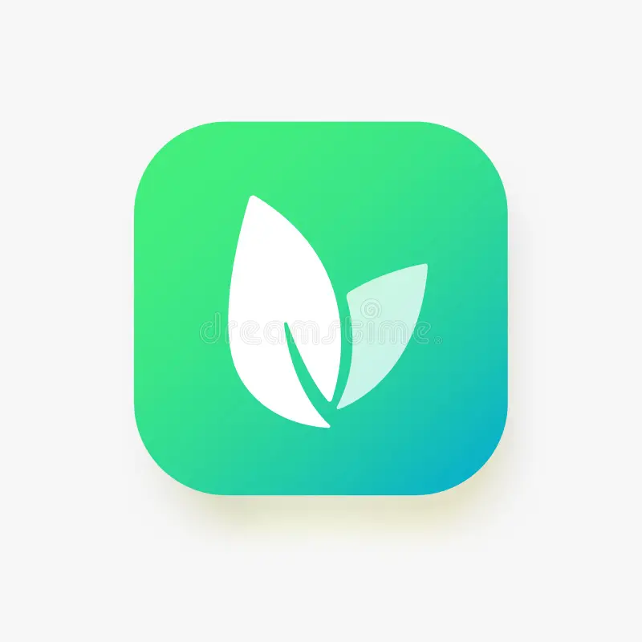

<div align="center">

  

  <h1>EcoGom App - Smart Waste Mobile Application</h1>
  <h3>Ứng Dụng Di Động Tra Cứu Lịch Thu Gom, Bản Đồ Điểm Gom Rác & Phân Loại Thông Minh</h3>

  <p>
    Ứng dụng di động đa nền tảng (Android & iOS) phục vụ người dân và đội ngũ vệ sinh môi trường: 
    Tra cứu phân loại rác thải tại nguồn, định vị bản đồ số các điểm thu gom tập trung bằng GPS thời gian thực, 
    theo dõi lịch xe rác theo tuần cho từng thôn xóm và tối ưu hóa trải nghiệm tương tác trực quan, mượt mà.
  </p>

  <p>
    
    
    
    
    
    
  </p>

</div>

<br />

# MOBILE APPLICATION & SMART RECYCLING COMPANION

Đây là kho lưu trữ chứa mã nguồn **Mobile Application** của hệ sinh thái **EcoGom**. Ứng dụng được xây dựng trên nền tảng **React Native 0.81.5** và **Expo SDK 54**, đáp ứng chuẩn mực thiết kế ứng dụng di động hiện đại, hỗ trợ đa nền tảng Android và iOS, mang đến giải pháp công nghệ tiện ích cho cộng đồng trong công tác quản lý và phân loại rác thải sinh hoạt.

Ứng dụng đã được rà soát và nâng cấp thư viện mạng **Axios** lên phiên bản an toàn `^1.20.0` nhằm ngăn chặn các nguy cơ tấn công SSRF và Prototype Pollution.

---

## Mục lục

- [1. Công nghệ & Thư viện Cốt lõi](#1-công-nghệ--thư-viện-cốt-lõi)
  - [Nền tảng Di động Cốt lõi](#nền-tảng-di-động-cốt-lõi)
  - [Giao diện Người dùng, Biểu tượng & Hoạt họa](#giao-diện-người-dùng-biểu-tượng--hoạt-họa)
  - [Bản đồ Không gian, Định vị & Mạng](#bản-đồ-không-gian-định-vị--mạng)
- [2. Tính năng Giao diện & Kiến trúc Trải nghiệm Người dùng](#2-tính-năng-giao-diện--kiến-trúc-trải-nghiệm-người-dùng)
  - [2.1. Màn hình Chính & Tra Cứu Phân Loại Rác](#21-màn-hình-chính--tra-cứu-phân-loại-rác)
  - [2.2. Lịch Trình Thu Gom Theo Thôn Xóm & Thời Gian Thực](#22-lịch-trình-thu-gom-theo-thôn-xóm--thời-gian-thực)
  - [2.3. Bản Đồ Số Thu Gom & Định Vị Vệ Tinh GPS](#23-bản-đồ-số-thu-gom--định-vị-vệ-tinh-gps)
  - [2.4. Hộp Thoại Chi Tiết & Hướng Dẫn Tái Chế](#24-hộp-thoại-chi-tiết--hướng-dẫn-tái-chế)
- [3. Demo Giao diện Ứng dụng](#3-demo-giao-diện-ứng-dụng)
- [4. Hướng dẫn Cài đặt & Khởi chạy](#4-hướng-dẫn-cài-đặt--khởi-chạy)
- [5. Cấu trúc Thư mục Dự án](#5-cấu-trúc-thư-mục-dự-án)
- [6. Kết nối Backend API Service](#6-kết-nối-backend-api-service)
- [7. Tác giả](#7-tác-giả)

---

## 1. Công nghệ & Thư viện Cốt lõi

Ứng dụng di động được xây dựng trên hệ sinh thái React Native và Expo hiện đại:

### Nền tảng Di động Cốt lõi

| Công nghệ / Thư viện | Phiên bản | Vai trò Kỹ thuật |
| :--- | :--- | :--- |
| **[Expo SDK](https://expo.dev/)** | `~54.0.32` | Nền tảng phát triển ứng dụng di động native, quản lý vòng đời và môi trường thực thi |
| **[React Native](https://reactnative.dev/)** | `0.81.5` | Framework phát triển ứng dụng di động đa nền tảng hiệu năng cao |
| **[React](https://react.dev/)** | `19.1.0` | Thư viện UI cốt lõi phiên bản React 19 với Hooks và khả năng tối ưu hóa render |
| **[TypeScript](https://www.typescriptlang.org/)** | `~5.9.2` | Đảm bảo tính an toàn kiểu dữ liệu tĩnh 100% trên toàn bộ mã nguồn |

---

### Giao diện Người dùng, Biểu tượng & Hoạt họa

| Công nghệ / Thư viện | Phiên bản | Vai trò Kỹ thuật |
| :--- | :--- | :--- |
| **[Lucide React Native](https://lucide.dev/)** | `^0.563.0` | Bộ biểu tượng vector SVG chuyên nghiệp, sắc nét (thay thế hoàn toàn chat emoji) |
| **[Expo Linear Gradient](https://docs.expo.dev/versions/latest/sdk/linear-gradient/)** | `~15.0.8` | Xử lý hiệu ứng màu chuyển sắc mượt mà cho các khối thẻ và tiêu đề ứng dụng |
| **[React Native Safe Area Context](https://github.com/th3rdwave/react-native-safe-area-context)** | `~5.6.0` | Xử lý an toàn khoảng đệm tai thỏ (Notch) trên iOS và Edge-to-Edge trên Android |
| **[React Native SVG](https://github.com/software-mansion/react-native-svg)** | `15.12.1` | Hỗ trợ hiển thị và tương tác với các đồ họa vector SVG chất lượng cao |
| **[Expo Status Bar](https://docs.expo.dev/versions/latest/sdk/status-bar/)** | `~3.0.9` | Tùy biến thanh trạng thái hệ thống đồng bộ theo tông màu ứng dụng |

---

### Bản đồ Không gian, Định vị & Mạng

| Công nghệ / Thư viện | Phiên bản | Vai trò Kỹ thuật |
| :--- | :--- | :--- |
| **[Expo Location](https://docs.expo.dev/versions/latest/sdk/location/)** | `~19.0.8` | Truy xuất tọa độ địa lý GPS thời gian thực từ cảm biến phần cứng của thiết bị |
| **[React Native WebView](https://github.com/react-native-webview/react-native-webview)** | `13.15.0` | Nhúng và vận hành bản đồ tương tác Leaflet mượt mà không gây xung đột native |
| **[Axios](https://axios-http.com/)** | `^1.20.0` | Tầng giao tiếp HTTP Client an toàn kết nối REST API Backend |

---

## 2. Tính năng Giao diện & Kiến trúc Trải nghiệm Người dùng

Ứng dụng tập trung tối ưu hóa trải nghiệm tra cứu rác thải và lịch trình nhanh chóng:

### 2.1. Màn hình Chính & Tra Cứu Phân Loại Rác
* **Thanh Tìm Kiếm Nhanh (Debounced Search):**
  Cho phép người dân gõ từ khóa tên rác thải (ví dụ: *chai nhựa, pin, vỏ chuối, bóng đèn*) để nhận kết quả phân loại ngay lập tức.
* **Bộ Lọc Phân Loại 4 Nhóm:**
  Thanh cuộn ngang các thẻ phân loại (*Tất cả, Rác tái chế, Rác hữu cơ, Rác nguy hại, Rác khác*) kèm mã màu nhận diện thương hiệu rõ ràng.
* **Thẻ Rác Trực Quan:**
  Hiển thị hình ảnh minh họa, huy hiệu phân loại và tóm tắt ngắn về mức độ ảnh hưởng môi trường.

---

### 2.2. Lịch Trình Thu Gom Theo Thôn Xóm & Thời Gian Thực
* **Lựa Chọn Địa Bàn Sinh Sống:**
  Cho phép chọn nhanh Xã/Phường và Thôn/Xóm nơi cư trú, hệ thống tự động ghi nhớ tùy chọn cho các phiên tiếp theo.
* **Thẻ Lịch Thu Gom Hôm Nay:**
  Tự động đối soát thứ trong tuần hiện tại để hiển thị khung giờ xe gom rác sắp đến và chủng loại rác được tiếp nhận trong ngày.
* **Lịch Trình Toàn Tuần (Weekly Calendar):**
  Xem trước lịch trình gom rác của các ngày còn lại trong tuần, giúp người dân chủ động tập kết rác đúng giờ.

---

### 2.3. Bản Đồ Số Thu Gom & Định Vị Vệ Tinh GPS
* **Bản Đồ Tương Tác Leaflet (WebView):**
  Tích hợp bản đồ số cho phép phóng to, thu nhỏ và di chuyển trên toàn khu vực địa bàn thu gom.
* **Định Vị Tức Thời (GPS My Location):**
  Yêu cầu quyền truy cập vị trí và hiển thị biểu tượng chấm xanh định vị người dùng trên bản đồ.
* **Ghim Điểm Thu Gom Rác (Collection Points):**
  Hiển thị tất cả các điểm tập kết thu gom rác xung quanh kèm thông tin khoảng cách và địa chỉ chi tiết.

---

### 2.4. Hộp Thoại Chi Tiết & Hướng Dẫn Tái Chế
* **Hộp Thoại Chi Tiết Rác Thải (Schedule & Waste Modal):**
  Cung cấp hướng dẫn từng bước: Cách làm sạch, đóng gói và thời điểm giao nộp rác thải an toàn cho môi trường.
* **Cảnh Báo Rác Nguy Hại:**
  Hiển thị cảnh báo trực quan đối với các loại rác thải điện tử, hóa chất và pin cần xử lý riêng biệt.

---

## 3. Demo Giao diện Ứng dụng

<div align="center">
  
  <p><em>Giao diện Ứng dụng Di động EcoGom App trên thiết bị Smartphone</em></p>
</div>

---

## 4. Hướng dẫn Cài đặt & Khởi chạy

### Yêu cầu Hệ thống
* **Node.js:** Phiên bản `>= 20.0.0` (Khuyến nghị **Node.js 20.x** hoặc **22.x LTS**).
* **Trình quản lý gói:** `npm` (>= 9), `yarn`, `pnpm` hoặc `bun`.
* **Công cụ chạy thử nghiệm:**
  - Cài đặt ứng dụng **Expo Go** trên điện thoại Android hoặc iOS.
  - Hoặc thiết lập máy ảo **Android Studio Emulator** / **iOS Simulator**.
* **Backend API:** Máy chủ **EcoGom Backend API** đang hoạt động tại cổng `3001`.

### Quy trình Cài đặt

```bash
# 1. Tải mã nguồn về máy cục bộ
git clone https://github.com/hvt299/EcoGom-App.git
cd EcoGom-App

# 2. Cài đặt toàn bộ thư viện phụ thuộc
npm install
```

### Cấu hình Biến Môi trường (.env)

Tạo tệp `.env` tại thư mục gốc `EcoGom-App/`:

```env
# Địa chỉ URL máy chủ Backend API (thay IP_MAY_TINH bằng địa chỉ IP mạng nội bộ của bạn)
EXPO_PUBLIC_API_URL=http://<IP_MAY_TINH_CHAY_BACKEND>:3001
```

> **Ghi chú:** Trên máy tính chạy Backend, mở terminal gõ `ipconfig` (trên Windows) để lấy địa chỉ IPv4 (ví dụ: `http://192.168.1.50:3001`).

### Các Lệnh Thực thi

```bash
# 1. Khởi chạy Metro Bundler
npm run start

# 2. Khởi chạy trực tiếp trên thiết bị hoặc máy ảo Android
npm run android

# 3. Khởi chạy trực tiếp trên máy ảo iOS (yêu cầu macOS)
npm run ios

# 4. Kiểm tra an toàn kiểu dữ liệu TypeScript (0 lỗi)
npx tsc --noEmit
```

Khi chạy `npm run start`, mở ứng dụng **Expo Go** trên điện thoại để quét mã QR hiển thị trên màn hình Terminal và bắt đầu trải nghiệm ứng dụng.

---

## 5. Cấu trúc Thư mục Dự án

```text
EcoGom-App/
├── assets/                    # Đồ họa tĩnh, logo ứng dụng và icon
│   ├── adaptive-icon.png      # Biểu tượng thích ứng cho Android
│   ├── icon.png               # Biểu tượng ứng dụng
│   ├── leaf-logo-light.png    # Logo nhận diện thương hiệu EcoGom
│   ├── leaf-logo-dark.png     # Logo phiên bản nền tối
│   └── splash-icon.png        # Màn hình Splash khi mở ứng dụng
├── src/
│   ├── components/            # Các thành phần giao diện tái sử dụng
│   │   ├── LeafletMap.tsx     # Bản đồ số nhúng WebView với định vị GPS
│   │   └── ScheduleDetailModal.tsx # Hộp thoại hiển thị lịch trình tuần
│   ├── screens/               # Màn hình giao diện chính
│   │   └── HomeScreen.tsx     # Màn hình trang chủ tích hợp tra cứu, lịch và bản đồ
│   ├── services/              # Tầng gọi API Backend
│   │   └── api.ts             # Axios Client kết nối REST API
│   ├── types/                 # Khai báo cấu trúc định kiểu TypeScript
│   │   ├── location.ts        # Thực thể điểm thu gom rác
│   │   ├── schedule.ts        # Thực thể lịch trình xe rác
│   │   └── waste.ts           # Thực thể danh mục rác thải
│   └── utils/                 # Các hàm xử lý dữ liệu và hỗ trợ
│       ├── dataProcessor.ts   # Xử lý nhóm dữ liệu địa bàn thôn xóm
│       └── wasteHelper.ts     # Tiện ích phân loại và mã màu danh mục
├── App.tsx                    # Điểm khởi động ứng dụng React Native
├── app.json                   # Cấu hình dự án Expo và phân quyền Geolocation
├── package.json               # Danh mục thư viện phụ thuộc và scripts
└── tsconfig.json              # Cấu hình trình biên dịch TypeScript
```

---

## 6. Kết nối Backend API Service

Ứng dụng di động được cấu hình để đồng bộ dữ liệu thời gian thực với **EcoGom Backend API**:
* Tự động gọi endpoint `/schedules/getFullByVillage` để nạp trước toàn bộ lịch trình, tối ưu hóa tốc độ cuộn trang và tiết kiệm dữ liệu di động 3G/4G.
* Khi kết nối bị gián đoạn, ứng dụng hiển thị thông báo thân thiện và tự động thử lại khi có mạng.
* Đảm bảo cập nhật chính xác địa chỉ IP máy chủ Backend vào tệp cấu hình `EXPO_PUBLIC_API_URL`.

---

## 7. Tác giả

Được phát triển bởi **Mr.T (hvt299)**  
GitHub: [https://github.com/hvt299](https://github.com/hvt299)
